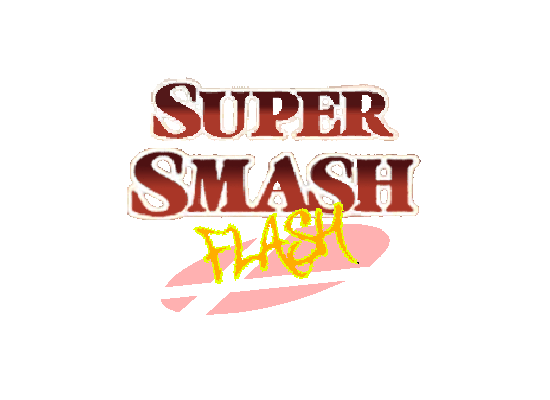

# Super Smash Flash (2006)

This is a snapshot of the source code for Super Smash Flash. It is designed purely for historical and educational purposes only. Please honor the respective licenses of any content contained within this repository.

### Notes

- The main source file is SuperSmashFlash.fla (requires Flash Pro CS6 or older which supports ActionScript 2.0)
- Use the "Scenes" panel in Flash to navigate to the different areas of the game menus
- AS2 supports placing scripts directly on symbols, where you will find much of the menu navigation code
- Stages in each "mode" contain hidden MovieClips that control the player objects
- Most of the player gameplay code is imported via the `#include` keyword

### List of used fonts
- Calisto MT
- Copperplate Gothic Bold
- Eurostile
- LilyUPC
- Matisse ITC
- Orange Kid
- Rockwell Extra Bold
- Sydnie
- Wide Latin
- fixed_v01
- kharon4a_mini

### Resources

- .doc -> Google Docs (for convenience)
    - [NarratorVoices.doc](https://docs.google.com/document/d/1KMD0XmXehsfCCWRA7arT9Lc1vdpy-YANfdGcqaDrbAc/edit?usp=sharing)
    - [SSF Variables.doc](https://docs.google.com/document/d/1xEDXPocmUjXG2FawYBL2WG6lNBZ5KdJRbyl_fi9aBAY/edit?usp=sharing)

----------------------

This project is not affiliated in any way with Nintendo nor any of its business partners. It is purely for archival purposes only.